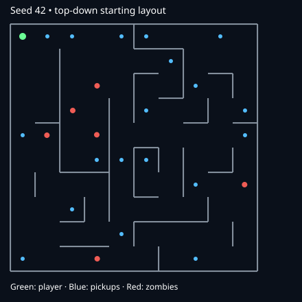

# Automated playtest and repair report

These tests fast-forward the actual browser game's movement, collision, raycast shooting, enemy AI, pickups, battery and spawn logic. They do not use a separate approximation of combat. The active bot uses perfect aim and no reaction delay. Results are engineering checks, not a human fun rating or a measured average Quest survival time. Actor spawning uses runtime randomness, so results vary on replay even with a fixed layout seed.

## Problems reproduced and repaired

- Waypoint stopping distance was 15 cm but the turn-alignment tolerance was 12 cm. Zombies could stop permanently just short of turns. Shared navigation logic now uses compatible tolerances, with collision-tested multi-turn route regressions.
- Spawns were selected by straight-line distance. Maze routes could be much longer, and zombies forgot the player before arriving. Spawns now use 4–7 graph steps; awakened zombies continue hunting and refresh their target periodically.
- Initial pickups occupied fixed grid columns. Placement now guarantees starter loot 1, 2 and 4 graph steps from spawn, then spreads loot by graph separation. New timed drops appear nearby along actual routes; healing pickups remain until health is low enough to benefit.
- Audio was resumed after the asynchronous VR entry request, which can lose browser user activation. Audio now unlocks before VR entry, on pointer/keyboard input, and on controller selection. A master bus/analyser verifies output. Zombie pursuit sounds recur rather than only playing on initial detection.
- Reloading and fire timing now use the run clock, allowing fast-forward tests to exercise the same weapon rules correctly.

## Measured results

Before repair, idle-player seed 1 produced zero damage in 120 seconds, with the nearest zombie about 8 meters away. Seed 123456 took about 74 seconds for first contact. After repair, three idle tests produced first contact around 20–30 seconds and death around 38–45 seconds. An idle player is intentionally not a viable survival strategy.

Three 180-second active-bot runs killed 56–78 zombies and reached levels 5–6. A 900-second seed-42 run killed 1,390 zombies, reached level 29, ended at 83 health, and hit the 75-active-zombie ceiling. This optimistic bot shows that significant upgrades can sustain late survival; it does not establish typical human balance. More difficulty tuning should follow headset sessions.

Browser audio: context `running`, nonzero RMS signal around 0.05 during a gunshot. This verifies generation and routing to browser output; hardware volume, routing, spatial perception and headset audibility require listening on the actual device.

All 13 unit/property tests passed, including 1,000 layout seeds. Production build passed. Tests also cover multi-turn route traversal, spawn route distance, starter pickup distances, batteries, upgrades, lighting and VR direction math.

## Reproduce

```sh
npm install
npx playwright install chromium
npm test
npm run test:playtest
npm run test:bot
LONG_RUN=1 npm run test:bot
```

The browser scripts start their own Vite server on port 4180. `CHROME_PATH` can select a local Chromium binary. `?debug=1` exposes inspection/fast-forward helpers only when requested.


